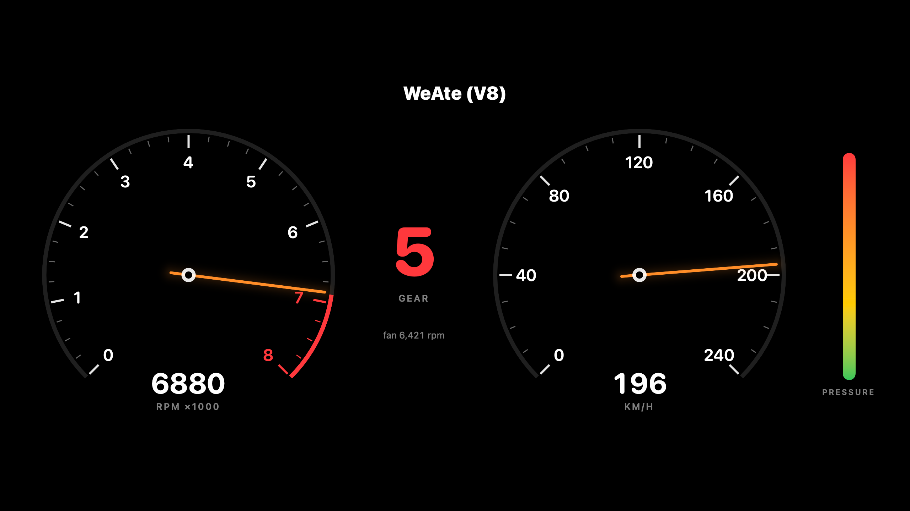
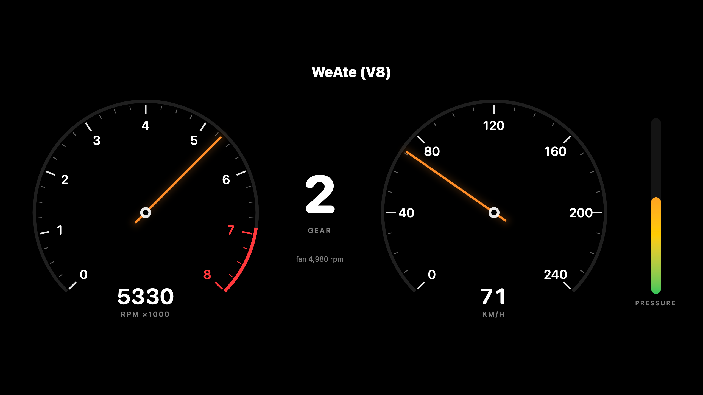

# WeAte (V8)

My MacBook is a V8 now.

The Force Touch trackpad is the gas pedal. Press it, and a simulated engine revs up through a five-speed gearbox, the **actual cooling fan** spins up and down with it, and a **synthesized cross-plane V8** rumbles out of the speakers. No recordings. Every bang is built from the crank angle.



**Hear it:** [`v8-sound.mp4`](docs/v8-sound.mp4) · [`v8-sound.wav`](docs/v8-sound.wav). 24 seconds of idle, flat out through all five gears into the limiter, then lifting off with overrun pops. Wear headphones, because each exhaust bank gets its own ear.

<!-- Inline player: drag docs/v8-sound.mp4 into GitHub's README editor and keep the user-attachments URL it inserts here. -->



---

## How it works

```
Force Touch trackpad ──▶ throttle 0…1 ──▶ Engine model (60 Hz) ──┬──▶ instrument cluster
   (raw pressure)       deadzone + curve   inertia, gears,       ├──▶ V8 synth (audio thread)
                                           limiter, road speed   └──▶ fan target (5 Hz) ──▶ AppleSMC ──▶ fan
```

| Piece | File | What it does |
|---|---|---|
| Throttle | `WeAteApp.swift` | Raw pressure → 0…1. A deadzone for a resting finger, full throttle at a firm press, and a curve so medium presses actually rev. |
| Engine | `Engine.swift` | Revs chase the throttle, rising fast and falling slower (inertia). 5-speed auto that cuts throttle on every shift, clutch slip at launch, drag, engine braking and a rev limiter that bounces. |
| V8 sound | `V8Sound.swift` | Spins a crank angle every audio sample and fires a cylinder every 90° in the order 1-8-4-3-6-5-7-2. Odd cylinders exhaust left, even right. |
| Fan | `SMC.swift` | Talks straight to AppleSMC through IOKit: reads fan speed, takes manual control, writes target RPM and hands control back. |
| Cluster | `Dial.swift` | Tacho with a redline, gear, speedo and a pressure bar. |

### Why a V8 sounds like a V8

A V8 fires evenly, one bang every quarter turn. But on a cross-plane crank, the two exhaust banks don't share those bangs evenly. With firing order 1-8-4-3-6-5-7-2 and odd cylinders on the left, the pipes get:

```
slot:   1   8   4   3   6   5   7   2
pipe:   L   R   R   L   R   L   L   R
```

That's four lopsided bangs per pipe, and those two uneven rhythms stacked on top of each other are the burble. That's exactly what the synth does. Each bang is a short noisy burst that rings a low pipe resonance. It barks harder under load and sometimes pops when you lift off at high revs.

---

## How it came together

It started with one question: **can my MacBook's fan rev like an engine, with the trackpad as the accelerator?**

I proved it one layer at a time on my M4 MacBook Pro, and didn't move on until each step worked on the real hardware:

1. **Read the trackpad.** Get continuous pressure, measure its actual range, and build a throttle around it.
2. **Read the SMC.** Talk to the System Management Controller directly and decode live fan speed.
3. **Control the fan.** Take manual control, set a target and give control back safely.
4. **Trackpad → fan.** It worked. The fan followed my finger.
5. **Make it feel like an engine.** Inertia, gears, a limiter.

Then I hit the real limit. The fan can do the **shape** of revving (climbing, falling, shifting), but what makes a V8 a V8 is individual explosions: **about 60 bangs a second at idle and about 470 at redline**. A fan needs seconds to change speed. So the fan became the engine's breathing, and the rumble got its own physically modelled synth, driven by the same engine.

---

## Problems I ran into

**Swift wouldn't lay out the 80-byte struct like C.**
AppleSMC takes a fixed 80-byte `SMCParamStruct`. My straight Swift translation came out at **76 bytes**. Swift slides the next field into a nested struct's tail padding (`size` 9 vs `stride` 12), and C doesn't. Everything after `keyInfo` was shifted, including the command byte. A `_pad: UInt16` puts the C offsets back (`result` @ 40, `data8` @ 42, `bytes` @ 48, size 80), and `precondition`s make sure it never drifts again.

**Two byte orders in one protocol.**
Key names are packed big-endian (`"FNum"` → `0x464E756D`). Fan speeds on Apple Silicon are `flt `, a **little-endian** Float32. So everything gets decoded by the type the SMC reports, never by key name.

**Two different things that can say no.**
As a normal user, writes die in the **kernel** (`0xe00002c1`, `kIOReturnNotPrivileged`) and never reach the SMC. As root, the request reaches the **SMC firmware**, which has its own refusal code (result `130`). Logging these two separately is how I figured out everything below.

**The M4 firmware gate.**
Measured on my machine:
- `F0Md` (fan mode) rejects every write while `Ftst` is `0`.
- After `Ftst = 1`, a **stopped** fan takes about **6 s** before it accepts manual mode. One that's already spinning takes about **0.2 s**.
- You can't request `3`. Ask for auto with `0`, and the firmware flips it to `3` itself.

So taking control retries with a timeout, and if anything fails it hands control straight back.

**Never leave the fan stuck in manual.**
Firmware control goes back on quit, Ctrl-C and `kill`, and again at launch in case the last run crashed. Every restore is checked by reading the keys back.

**Pressing way too hard.**
The sensor tops out around 331 (raw ÷ 10), and a straight linear map meant really leaning on the trackpad to hit redline. A deadzone of 40, full throttle at 140 and a 0.5 curve put the whole rev range under a normal press.

**The audio thread vs Swift 6.**
The first live run crashed in `dispatch_assert_queue`. The render closure lived inside a `@MainActor` class, inherited main-actor isolation, and Swift trapped when CoreAudio called it from the real-time thread. `@Sendable` fixed it. The renderer itself never allocates or locks.

**A pipe that amplified 4000×.**
The narrow resonance turned one bang into a clipped wall of noise. Each pipe now measures a single bang at startup and scales itself, so a bang peaks around 0.6.

### SMC keys on my M4 MacBook Pro (one fan)

| Key | Type | Meaning | What I saw |
|---|---|---|---|
| `FNum` | `ui8 ` | fan count | 1 |
| `F0Ac` | `flt ` | actual RPM | 0 at idle, ~6550 boosted |
| `F0Mn` / `F0Mx` | `flt ` | min / max RPM | 2317 / 6550 |
| `F0Tg` | `flt ` | target RPM | what WeAte writes |
| `F0Md` | `ui8 ` | mode: 0/3 auto, 1 manual | 3 at rest |
| `Ftst` | `ui8 ` | firmware unlock | 0 at rest |

Side find: the writable keys (`F0Tg`, `F0Md`, `Ftst`) report attribute byte `0xD0`/`0xD4`, and the read-only ones `0x84`/`0x85`. The `0x40` bit looks like "writable".

---

## Running it

**You'll need:** an Apple Silicon Mac with a fan and a Force Touch trackpad, macOS 15+, and Swift 6.4. I've only tested it on my **M4 MacBook Pro (one fan)**, and other Macs might expose different keys, ranges or firmware behaviour.

Fan writes need root:

```bash
swift build && sudo "$(swift build --show-bin-path)/WeAte"
```

Or open `Package.swift` in Xcode, go to **Product → Scheme → Edit Scheme → Run → Info**, and set **Debug Process As: root**.

Then:
1. Give it a few seconds after launch while it takes over the fan.
2. Press the trackpad. A firm press is full throttle, and letting go coasts down.
3. Quit with ⌘Q or Ctrl-C, and the fan goes back to firmware control.

> ⚠️ **This writes to your Mac's System Management Controller.** It always hands control back and checks that it worked, but a `kill -9` or power loss can't be caught. The next launch (or a reboot) puts it back on auto. Use it at your own risk, and don't run another fan-control app at the same time.

### Experiments

`Sources/Experiments/` has the scratch scripts I used to figure out the struct layout:

```bash
swift Sources/Experiments/smc-layout.swift
```

---

## Credits

- **[OpenMultitouchSupport](https://github.com/KrishKrosh/OpenMultitouchSupport)** (MIT), for raw Force Touch trackpad data.
- **The macOS community's reverse-engineering of AppleSMC**, for the user-client protocol (selector 2, the read/write/key-info commands, the 80-byte parameter struct) and the fan key names. [Vorssaint Utils](https://github.com/vorssaint/vorssaint-utils) was my known-working reference for how fan control behaves on this hardware. No code was taken from it.

## License

MIT, see [LICENSE](LICENSE).
